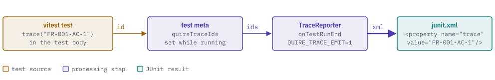
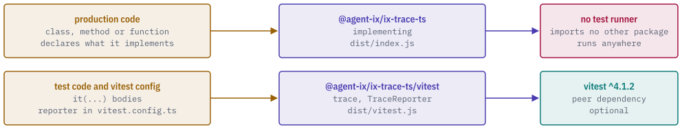

# @agent-ix/ix-trace-ts

[](https://www.npmjs.com/package/@agent-ix/ix-trace-ts)
[](https://discord.gg/k8DVhuYBR2)
[](#license)

@agent-ix/ix-trace-ts is a vitest reporter and a pair of helpers that bind source code to requirement ids. `trace()` declares the ids a test verifies, and `implementing()` declares the ids a class, method or function implements.

With `QUIRE_TRACE_EMIT=1`, the reporter writes each test's ids into the JUnit XML file as a `trace` property, so a requirement can be traced to the tests that verify it. `implementing()` checks that each id is id-shaped and returns the marked declaration unchanged.

<picture>
  <source media="(prefers-color-scheme: dark)" srcset="https://raw.githubusercontent.com/agent-ix/ix-trace-ts/main/docs/images/hero-dark.svg">
  
</picture>

## Getting started

```sh
npm install @agent-ix/ix-trace-ts
```

`vitest` `^4.1.2` is an optional peer dependency. Install it in any project that uses `trace()` or the reporter.

To build from a clone of [ix-trace-ts](https://github.com/agent-ix/ix-trace-ts), run `pnpm install`, then the targets under Building and testing.

## Usage

The package has two entries. `trace` and `TraceReporter` come from `@agent-ix/ix-trace-ts/vitest`, the only entry that loads vitest. The package root exports `implementing` only and imports no other package, so production code that uses it runs where no test runner is installed.

<picture>
  <source media="(prefers-color-scheme: dark)" srcset="https://raw.githubusercontent.com/agent-ix/ix-trace-ts/main/docs/images/entries-dark.svg">
  
</picture>

### Declaring what a test verifies

Add the reporter to `vitest.config.ts`:

```ts
import { TraceReporter } from "@agent-ix/ix-trace-ts/vitest";
export default {
  test: { reporters: [new TraceReporter({ outputFile: "junit.xml" })] },
};
```

Call `trace()` in a test body:

```ts
import { trace } from "@agent-ix/ix-trace-ts/vitest";
it("verifies the thing", () => {
  trace("FR-001-AC-1");
});
```

Run `QUIRE_TRACE_EMIT=1 npx vitest run`. `junit.xml` then holds:

```xml
<testcase classname="verifies the thing" file="parser.test.ts" name="verifies the thing" time="0.0017">
    <property name="trace" value="FR-001-AC-1"/>
</testcase>
```

Without `QUIRE_TRACE_EMIT=1`, `trace()` returns immediately and the reporter writes vitest's plain JUnit output.

### Declaring what production code implements

```ts
import * as ixTrace from "@agent-ix/ix-trace-ts";

@ixTrace.implementing("FR-007-AC-1")
export class Parser {
  @ixTrace.implementing("FR-007-AC-2")
  parse() {}
}

export const load = ixTrace.implementing("FR-007-AC-3")(() => 1);
```

A class, method, getter or setter takes `implementing()` as a decorator, under standard decorators or `experimentalDecorators`. A function is written as a `const` arrow or function expression wrapped by `implementing(...)(fn)`, which returns the function unchanged. Write ids as double-quoted literals so they bind statically.

When vitest runs a file that uses decorators, set `"experimentalDecorators": true` in `tsconfig.json`.

## Reference

### `@agent-ix/ix-trace-ts`

| Export                         | Description                                                                                                                                                                                           |
| ------------------------------ | ----------------------------------------------------------------------------------------------------------------------------------------------------------------------------------------------------- |
| `implementing(first, ...rest)` | Declares the ids the marked class, method, getter, setter or function implements. Returns a decorator and wrapper (`Implementing`). Throws `TypeError` when no id is given or an id is not id-shaped. |

An id is id-shaped when it is a kind followed by hyphen-separated alphanumeric segments, at least one containing a digit, for example `FR-007-AC-1`.

### `@agent-ix/ix-trace-ts/vitest`

| Export                 | Description                                                                                                                                                          |
| ---------------------- | -------------------------------------------------------------------------------------------------------------------------------------------------------------------- |
| `trace(...ids)`        | Declares the ids the running test verifies. Does nothing unless `QUIRE_TRACE_EMIT=1`. Throws outside a running test and in a concurrent test.                        |
| `TraceReporter`        | vitest reporter, also the default export. Without `QUIRE_TRACE_EMIT=1` it is vitest's own JUnit reporter. With it, it writes the JUnit file with `trace` properties. |
| `TraceReporterOptions` | Constructor options for `TraceReporter`.                                                                                                                             |

`TraceReporterOptions` has one field, `outputFile`, the path of the JUnit file. It defaults to vitest's `outputFile` config. When neither is set, the XML is printed to the log.

With `QUIRE_TRACE_EMIT=1`, the reporter writes one `<testcase>` per test. `name` and `classname` are the title as written in source (for `it.each`, the template title), `file` is the repo-relative path, and each distinct id appears once in the `trace` property, comma-separated. jest is unsupported.

### Environment

| Variable           | Description                                                                   |
| ------------------ | ----------------------------------------------------------------------------- |
| `QUIRE_TRACE_EMIT` | Enables emission when set to exactly `1`. Any other value leaves it disabled. |

## Building and testing

```sh
pnpm install
make build
make test
make lint
```

`make format` applies prettier.

## Contributing

See the [Agent IX contributing guide and CLA](https://github.com/agent-ix/.github) and [`CONTENT_RIGHTS.md`](CONTENT_RIGHTS.md).

## License

AGPL-3.0-or-later. See [`LICENSE`](LICENSE).
